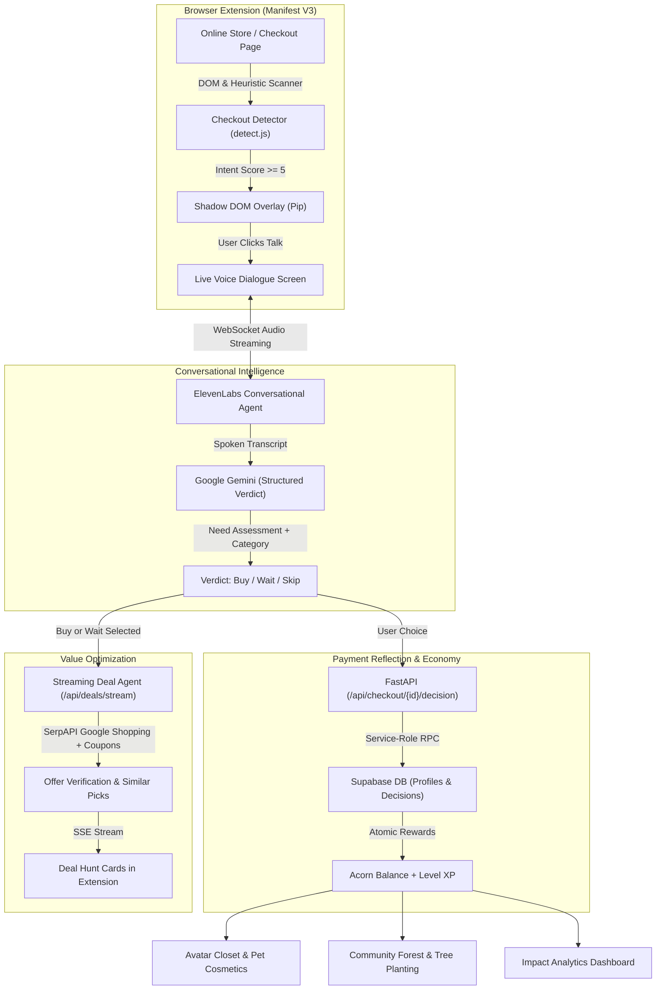

# Nook — Squirrel Savings

> **"Every loyalty program rewards you for spending more. Ours rewards you for spending well."**  
> *Built for DubHacks '26 — Reimagine Shopping (Visa Sponsor Track)*

[](https://fastapi.tiangolo.com/)
[](https://developer.chrome.com/docs/extensions/)
[](https://deepmind.google/technologies/gemini/)
[](https://elevenlabs.io/)
[](https://supabase.com/)
[](https://www.python.org/)

---

## Executive Summary & Visa Track Fit

### The Problem: The Cost of Frictionless Payments
Modern digital commerce has perfected the frictionless transaction. One-click checkouts, saved cards, autofill, and buy-now-pay-later (BNPL) services make spending instantaneous. However, removing checkout friction has created two severe unintended consequences:
1. **Shopper Regret & Financial Vulnerability:** Over **73% of online purchases are impulse buys**, driving escalating credit card debt and buyer's remorse.
2. **The $800B+ Merchant & Issuer Return Crisis:** High-impulse purchasing fuels massive return volumes, reverse logistics expenses, payment dispute processing, and chargeback overhead for merchants and payment networks.
3. **Incentive Misalignment in Traditional Loyalty:** Conventional rewards and cashback programs give cardholders 1–2% back only when they spend *more*. No existing payment platform actively incentivizes *spending mindfulness*.

### The Visa Opportunity: Reimagining Shopping & Payment Authorization
**Nook** reimagines the role of payments by introducing a thoughtful, conversational pause right before money leaves the account:
- **Intelligent Pre-Authorization Reflection:** Nook injects **Pip**, an AI squirrel voice companion, at the exact moment of checkout. In a 30-to-45-second natural voice exchange, Pip asks why the shopper needs the item, helping them weigh need vs. impulse.
- **Cardholder Value & Deal Verification:** When a purchase is genuinely needed, Nook's background **Deal Agent** automatically scours the web (Google Shopping, live coupons, price checks) to verify whether the price is fair, surface cheaper exact matches, or recommend high-confidence alternative picks.
- **Rewarding Financial Wellness:** By partnering with payment networks like Visa, loyalty shifts from rewarding reckless consumerism to rewarding financial intentionality. Shoppers earn **Acorns** and **XP** for reflecting, waiting, or skipping. Acorns can be spent on in-game cosmetics or pooled into real-world tree planting pledges.
- **Universal Merchant Compatibility:** Works across all e-commerce sites (Amazon, Shopify, Target, Walmart, Best Buy, Stripe, PayPal) with zero merchant integration required.

---

## How It Works



---

## Key Features

### 1. Zero-Friction Checkout Interception
- **Universal Heuristic Detection:** Evaluates page paths, credit card inputs, Stripe/PayPal checkout buttons, and cart totals across major retailers without needing site-specific scrapers.
- **Shadow DOM Isolation:** Renders Pip's friendly companion interface safely into any store page without styling conflicts.

### 2. Conversational Voice Reflection (Pip the Squirrel)
- **Real-Time Voice Streaming:** Powered by **ElevenLabs Conversational AI** and **Eleven Turbo TTS** for ultra-low latency audio turn-taking.
- **Structured Rationale Assessment:** Powered by **Google Gemini**, evaluating whether the shopper's intent is a `clear_need`, `unsure`, or `impulsive`, and categorizing the item into one of 19 standardized retail classifications.
- **User Agency Guaranteed:** Pip advises and challenges; the shopper always has the final word with persistent **Buy it**, **Wait 24 hours**, or **Skip** actions.

### 3. Real-Time Deal Hunter & "Similar Picks"
- **Automated Price Check:** If the shopper chooses to proceed with a purchase, Pip launches a live background hunt to ensure they are not overpaying.
- **Exact Matches & Coupon Engine:** Matches identical product identifiers, conditions, and calculates true total cost (price + shipping - verified coupon discounts).
- **Intelligent Similar Picks:** Uses Gemini with strict verification to suggest comparable, lower-cost items that satisfy the same shopper need (with honest trade-off disclosures).
- **Server-Sent Events (SSE):** Streams playful hunting steps live to the UI as Pip checks sellers.

### 4. Intentionality Loyalty & Progression Economy
- **Dual-Currency Progression:**
  - **Lifetime XP:** Immutable score determining squirrel evolution tier:  
    `Baby` (<250 XP) $\rightarrow$ `Scout` (<1,000 XP) $\rightarrow$ `Forager` (<3,000 XP) $\rightarrow$ `Hoarder` (<7,500 XP) $\rightarrow$ `Golden` (7,500+ XP).
  - **Spendable Acorns:** Earned by pausing, reflecting, waiting, or skipping.
- **Avatar Closet & Pet Companions:** Personalize Pip with hats, scarves, environments, and floating pet companions unlocked via intentional savings.
- **Personal Forest & Sustainable Impact:** Users can pledge 100 acorns to plant real trees, climbing the community leaderboard and connecting digital savings to environmental stewardship.
- **Impact Analytics Dashboard:** Comprehensive financial telemetry tracking total money saved, decision distribution (Avoided vs. Postponed vs. Proceeded), and weekly savings trends.
- **Personalized Shopper Onboarding:** Interactive interview that tailors Pip's advice to the user's personal financial goals and impulse shopping triggers.

---

## Tech Stack & Architecture

| Layer | Technologies | Purpose |
| :--- | :--- | :--- |
| **Browser Extension** | Chrome Manifest V3, Vite, Vanilla CSS | Lightweight, cross-store content injection and UI popup |
| **Backend API** | FastAPI, Python 3.11, Uvicorn, Pydantic v2, HTTPX | High-concurrency REST & SSE streaming backend |
| **Language & Reasoning AI** | Google Gemini 2.5 Flash (`google-genai` SDK) | Intent assessment, structured verdicts, and similar-pick generation |
| **Voice & Speech AI** | ElevenLabs Conversational AI & Eleven Turbo TTS | Sub-second voice synthesis and real-time audio dialogues |
| **Database & Identity** | Supabase (PostgreSQL 15), Supabase Auth (PKCE OAuth) | User profile tracking, session audit trail, and RLS policies |
| **Search & Deal Verification** | SerpAPI (Google Shopping), Custom Coupon Verification | Real-time market offer discovery and mathematical savings validation |

---

## Getting Started

### Prerequisites
- **Node.js** (v18+) and **npm**
- **Python** (3.11+)
- **Google Cloud Console** (OAuth 2.0 Web Client credentials)
- **Supabase** account (Free tier supported)
- **Gemini API Key** (Google AI Studio)
- **ElevenLabs API Key** & Agent ID (Optional for voice streaming; fallback TTS included)
- **SerpAPI Key** (Optional; set `DEMO_MODE=1` to use canned product fixtures)

---

### Step 1: Supabase Configuration

1. Create a new Supabase project at [supabase.com](https://supabase.com).
2. In Google Cloud Console, create an OAuth client of type **Web application**.
3. In Supabase **Authentication → Sign In / Providers → Google**:
   - Enable Google, paste the Client ID and Secret.
   - Copy the Supabase callback URL (e.g., `https://<ref>.supabase.co/auth/v1/callback`) and paste it as an **Authorized redirect URI** in Google Cloud.
4. In Supabase **Authentication → URL Configuration → Redirect URLs**:
   - Add your Chrome Extension callback URL: `https://<your-extension-id>.chromiumapp.org/`.
5. Open the **SQL Editor** in Supabase and execute the schema and migration scripts in order:
   - [`supabase/schema.sql`](file:///c:/Users/rohit/dubhacks26/supabase/schema.sql)
   - [`supabase/migrations/20261017_recommendation_rewards.sql`](file:///c:/Users/rohit/dubhacks26/supabase/migrations/20261017_recommendation_rewards.sql)
   - [`supabase/migrations/20261018_avatar_cosmetics.sql`](file:///c:/Users/rohit/dubhacks26/supabase/migrations/20261018_avatar_cosmetics.sql)
   - [`supabase/migrations/20261018_pet_cosmetics.sql`](file:///c:/Users/rohit/dubhacks26/supabase/migrations/20261018_pet_cosmetics.sql)
   - [`supabase/migrations/20261018_cosmetic_unequip.sql`](file:///c:/Users/rohit/dubhacks26/supabase/migrations/20261018_cosmetic_unequip.sql)
   - [`supabase/migrations/20261018_purchase_category.sql`](file:///c:/Users/rohit/dubhacks26/supabase/migrations/20261018_purchase_category.sql)
   - [`supabase/migrations/20261018_category_values.sql`](file:///c:/Users/rohit/dubhacks26/supabase/migrations/20261018_category_values.sql)
   - [`supabase/migrations/20261018_quests_forest.sql`](file:///c:/Users/rohit/dubhacks26/supabase/migrations/20261018_quests_forest.sql)
   - [`supabase/migrations/20261018_deal_checks.sql`](file:///c:/Users/rohit/dubhacks26/supabase/migrations/20261018_deal_checks.sql)
   - [`supabase/migrations/20261018_onboarding.sql`](file:///c:/Users/rohit/dubhacks26/supabase/migrations/20261018_onboarding.sql)

---

### Step 2: Backend Setup

```bash
cd backend

# Create and activate virtual environment
python -m venv .venv
source .venv/bin/activate       # On Windows: .venv\Scripts\activate

# Install dependencies
pip install -r requirements.txt

# Configure environment variables
cp .env.example .env
```

Edit `backend/.env`:
```ini
SUPABASE_URL=https://<your-project-ref>.supabase.co
SUPABASE_SERVICE_ROLE_KEY=<your-service-role-key>
SUPABASE_JWT_SECRET=<your-supabase-jwt-secret>
INTERNAL_SERVICE_TOKEN=<strong-random-token>

GEMINI_API_KEY=<your-gemini-api-key>
GEMINI_MODEL=gemini-2.5-flash

ELEVENLABS_API_KEY=<your-elevenlabs-api-key>
ELEVENLABS_AGENT_ID=<your-elevenlabs-agent-id>

SERPAPI_KEY=<your-serpapi-key>
DEMO_MODE=1                     # Set to 1 for offline fixture demo mode
```

Run the backend server:
```bash
uvicorn app.main:app --reload --port 8000
```
Interactive OpenAPI documentation will be accessible at [http://localhost:8000/docs](http://localhost:8000/docs).

---

### Step 3: Chrome Extension Setup

```bash
cd extension

# Configure extension environment
cp .env.example .env
```

Edit `extension/.env`:
```ini
VITE_SUPABASE_URL=https://<your-project-ref>.supabase.co
VITE_SUPABASE_ANON_KEY=<your-supabase-anon-key>
VITE_API_BASE_URL=http://localhost:8000
```

Install and build:
```bash
npm install
npm run dev                     # Watches and rebuilds extension/dist/ automatically
```

**Load the extension in Chrome:**
1. Navigate to `chrome://extensions/`.
2. Toggle on **Developer mode** in the top right.
3. Click **Load unpacked** and select the `dubhacks26/extension/dist/` directory.
4. Copy the extension's generated ID and ensure it is added to your Supabase Redirect URLs list.

---

### Step 4: Trying the End-to-End Demo

Launch the included mock retail store:
```bash
cd extension
npm run demo                    # Serves demo store at http://localhost:4321
```

1. Navigate to [http://localhost:4321/checkout.html](http://localhost:4321/checkout.html) in Chrome.
2. Observe Pip's checkout overlay automatically appearing in the lower-right corner.
3. Click **Talk to Pip** (or open the Nook extension popup).
4. Experience the voice check-in, test button choices (*Skip*, *Wait 24h*, *Buy*), watch your **Acorn stash grow**, and trigger Pip's **Deal Hunt** to uncover cheaper options across the web.

---

## Testing & Quality Assurance

Run backend unit and integration tests:
```bash
cd backend
pytest -v
```

Run content script and checkout detection tests:
```bash
cd extension
npm test
```

Test the Deal Agent on a standalone product URL:
```bash
cd backend
python -m scripts.try_product https://www.bestbuy.com/site/6505727.p --title "Sony WH-1000XM5" --price 399.99
```

---

## Security & Architectural Principles

- **Zero Client-Side Secrets:** `SUPABASE_SERVICE_ROLE_KEY`, `GEMINI_API_KEY`, and `SERPAPI_KEY` are strictly maintained in the backend server. The Chrome extension only ever holds public anonymous keys.
- **Row-Level Security (RLS):** All Supabase tables protect user privacy. Shoppers can only read their own session logs and progress.
- **Atomic Reward Enforcement:** XP awards and acorn balance deductions are executed through Postgres stored procedures (`record_checkout_decision`, `purchase_cosmetic`, `plant_trees`), preventing race conditions, balance tampering, and replay exploits.
- **Graceful Network Degradation:** If network connectivity to external search APIs is unavailable, the Deal Agent and Voice Engine fail gracefully to structured local heuristics and cached fixtures without crashing the checkout experience.

---

## Team & Acknowledgments

Built with dedication for **DubHacks '26**.  
*Special thanks to the Visa team for inspiring us to rethink commerce, payments, and consumer financial well-being.*
