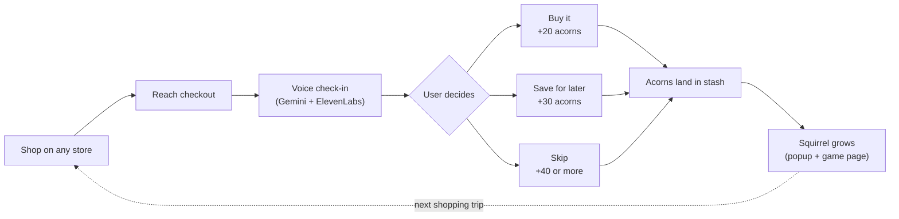
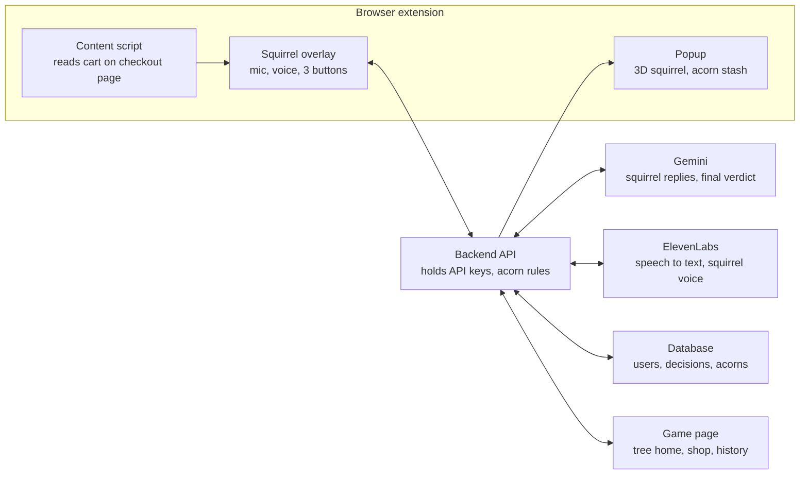

# Squirrel Savings — Design Doc

Oct 17, 2026 · William

## Overview

A browser plugin where an AI squirrel talks with you at checkout: you either justify the purchase or it convinces you to skip, and either decision earns acorns that grow your squirrel in a 3D game.

**Problem.** Online checkout is built to be frictionless, so impulse buys and regret returns are easy. Loyalty programs make it worse by rewarding spending more. Cashback apps like Rakuten and Honey are passive: people forget them, and 2% back feels like nothing.

**Our answer.** Add one short, friendly moment of reflection right before paying. A voice conversation powered by Gemini and ElevenLabs asks why you want this item. Whatever you decide, you are rewarded for deciding thoughtfully, and skipping earns more. The reward is visible progress: acorns pile up and the squirrel evolves.

**Track fit (DubHacks '26, Reimagine Shopping).** It transforms three stages of the journey:

- **Checkout:** the voice conversation happens inside the checkout page, with no app switching.
- **Payments:** the decision to pay, wait or skip is made with the squirrel's help.
- **Loyalty and rewards:** acorns, tiers and an evolving character replace a point balance.

**Pitch line.** "Every loyalty program rewards you for spending more. Ours rewards you for spending well."

## Goals and non-goals

The hackathon goal is one reliable end-to-end loop on a mock store: checkout, voice conversation, decision, acorns, squirrel evolves.

**Goals**

- A voice conversation at checkout that feels natural and finishes in under a minute.
- Reward both outcomes, with skipping worth more than buying.
- A 3D squirrel in the plugin popup that reacts and evolves through 5 tiers.
- A game page with the squirrel's tree home, unlocks and decision history.
- The user always has the final say: the squirrel advises, never blocks.

**Non-goals for the hackathon**

- Price comparison and coupons (dropped as unfeasible).
- Real affiliate-network integration or real-money rewards (pitched as the business model, simulated in the demo).
- Support for real stores like Amazon (mock store only; real stores are a stretch goal).
- Real payments: the mock store's checkout is fake.

## User flow

The user shops as normal; the plugin steps in once at checkout, and every outcome of the conversation feeds the game.



The user decides after the voice check-in, the acorns for that decision land in the stash, and the squirrel grows before the next shopping trip.

## The voice conversation

When the user reaches checkout, the squirrel slides into the page and asks out loud why they want what is in the cart; Gemini decides what to say and ElevenLabs gives the squirrel its voice.

**Trigger.** Checkout page only, one interruption per checkout. The content script reads the cart (items, prices, total) and sends it to the backend with the user's recent decisions and wishlist.

**Pipeline.** Two ways to build it; pick one in the first hour:

1. **ElevenLabs conversational agent (preferred if it works with our account):** ElevenLabs handles listening, turn-taking and the voice, with Gemini as the brain. Least code, most natural.
2. **Manual loop (fallback):** browser mic → ElevenLabs speech-to-text → Gemini → ElevenLabs text-to-speech. More code, full control.

**Squirrel persona.** Warm, curious and a little cheeky. It asks, it never lectures or shames. It uses the user's own context, such as "You bought a similar hoodie three weeks ago."

**Conversation rules**

- At most 3 squirrel turns, about 45 seconds in total.
- Open with one specific question about the cart, not a generic "are you sure?"
- If the reason is clear and fits the user's history, agree and wrap up.
- If it looks impulsive or duplicates a recent purchase, gently make the case to wait or skip.
- Three buttons stay on screen the whole time: **Buy it**, **Save for later**, **Skip**. The user can end the conversation at any moment.

**What Gemini returns at the end** (structured JSON for the backend):

```json
{
  "assessment": "clear_need | unsure | impulsive",
  "suggestion": "buy | wait | skip",
  "reason_summary": "Replacing broken running shoes before a race",
  "closing_line": "Sounds like a solid buy. Go get 'em!"
}
```

The decision itself comes from the user's button press, not from Gemini.

**Example**

> **Squirrel:** Ooh, $89 headphones! What are they for?
>
> **User:** For the gym, my old ones broke.
>
> **Squirrel:** Fair! Just checking: you bought earbuds two weeks ago. Are those not working out?
>
> **User:** They keep falling out when I run.
>
> **Squirrel:** Then over-ear makes sense. Good call. Want to grab them?

## Rewards and game

Every decision made through the conversation earns acorns, skipping earns the most, and acorns never scale with the amount spent. Numbers below are starting values to tune during testing.

**Earning acorns**

| Decision or action | Acorns | Notes |
| --- | --- | --- |
| Skip | 40 + 1 per $2 kept, max 150 | Pending for 7 days; cancelled if the same item is bought |
| Save for later | 30 | +20 more if bought after waiting 48 hours or more |
| Buy after the conversation | 20 | Flat, whatever the cart total |
| 3 conversations in a row without hitting Buy right away | +25 | Streak bonus |
| Daily cap | 300 | Limits gaming |

**Two numbers per user**

- **Total earned** decides the squirrel's tier and never goes down.
- **Balance** is spendable on cosmetics in the game page's shop.

**Tiers**

| Tier | Total earned | Squirrel | World |
| --- | --- | --- | --- |
| Baby | 0 | Small, plain brown | Bare ground, a few acorns |
| Scout | 250 | Normal size, backpack | Sapling |
| Forager | 1,000 | Fluffier tail, explorer hat | Young tree with a hollow |
| Hoarder | 3,000 | Glossy fur, scarf | Full tree home, lantern |
| Golden | 7,500 | Golden fur, crown | Glowing oak |

**Plugin popup (quick view)**

- The 3D squirrel (three.js) with an idle animation.
- The acorn stash, drawn as instanced acorns that grow with the balance.
- A progress bar to the next tier and the last decision with its acorns.
- After a decision, acorns fall into the stash; crossing a tier plays the evolution: glow, particle burst, new look.

**Game page (full world)**

- The squirrel's tree home, larger and more detailed than in the popup.
- The tier path with what each tier unlocks.
- A cosmetics shop (hats, scarves, decorations).
- Decision history, including a running total of money kept by skipping.

## Architecture

The extension handles everything on the page, and a small backend owns the API keys, the conversation and the acorn rules.



The overlay sends the cart and the user's decision to the backend, which calls Gemini and ElevenLabs and writes acorns to the database; the popup and game page read the result. If we use the ElevenLabs agent, the overlay streams audio to ElevenLabs through a short-lived link the backend issues, so keys never reach the browser.

**Stack**

- **Extension:** Manifest V3, Vite with the CRXJS plugin, three.js bundled from npm (no CDN scripts allowed). Overlay rendered in a shadow DOM so store CSS can't break it.
- **Backend:** Node with Express (or Python with FastAPI, whichever the pair knows best).
- **Database:** Firebase or Supabase for speed; SQLite is fine for the demo.
- **Game page:** a small React app with three.js, reading the same backend.

**Data model**

| Table | Key fields |
| --- | --- |
| users | id, total_earned, balance, tier, streak |
| decisions | id, user_id, store, items, cart_total, decision (buy, save, skip), acorns, status (pending, locked, cancelled), reason_summary, created_at |
| saved_items | id, user_id, item, price, saved_at, status (waiting, bought, dropped) |
| unlocks | user_id, item_id, unlocked_at |

**API contracts** (agree on these first so both pairs can build with fake data)

```text
POST /checkout/start
  in:  { user_id, cart: { store, items: [{ name, price, qty }], total } }
  out: { session_id, opening_line, voice_link }

POST /checkout/turn          (manual voice loop only)
  in:  { session_id, user_text }
  out: { reply_text, reply_audio_url, done }

POST /checkout/decision
  in:  { session_id, decision: "buy" | "save" | "skip" }
  out: { acorns_awarded, status, total_earned, balance, tier, tier_up }

GET /user/state
  out: { total_earned, balance, tier, next_tier_at, recent_decisions: [...] }
```

`tier_up: true` is the popup's cue to play the evolution animation.

## Team split and build plan

Two pairs build in parallel against the API contracts in Architecture, using fake data until the other side is ready.

| Owner | Workstream | Delivers |
| --- | --- | --- |
| William & Rohit | Conversation | Checkout detection, cart reading, Gemini prompt and persona, ElevenLabs voice, conversation overlay, decision buttons |
| Kevin & Deetya | Rewards and game | Mock store, backend and database, acorn rules and tiers, 3D squirrel popup, game page |

**Milestones** (hours from start)

1. **Hour 2:** API contracts agreed; mock store checkout page live; extension loads on it.
2. **Hour 6:** Squirrel overlay appears at checkout with a hardcoded question; buttons send a decision; backend awards acorns; popup shows the balance.
3. **Hour 12:** Real voice conversation working end to end with Gemini; 3D squirrel renders in the popup with acorns.
4. **Hour 18:** Tiers and evolution animation; game page with tree home and history; persona tuned.
5. **Final hours:** Feature freeze, seed demo account, rehearse the demo, record a backup video.

- [ ] Agree on API contracts (everyone)
- [ ] Choose the voice pipeline: ElevenLabs agent or manual loop (William & Rohit)
- [ ] Find or generate the squirrel 3D model (Kevin & Deetya)

## Demo script

Two minutes, two checkouts, one live evolution. Seed the demo account at about 980 total acorns, just under Forager.

1. **Hook (15 s):** "Checkout is designed so you never stop to think. Loyalty programs reward you for spending more. We flipped that."
2. **Checkout 1, the skip (40 s):** add a second hoodie to the cart on the mock store. The squirrel asks out loud why, mentions the hoodie bought three weeks ago, and the presenter decides to skip. Acorns go to pending; the popup shows them.
3. **Checkout 2, the justified buy (40 s):** buy gym headphones. The presenter explains the old ones broke; the squirrel agrees. Acorns fall in, total reaches 1,000, and the squirrel evolves into a Forager live.
4. **Game page (15 s):** tree home, tier path, money kept by skipping.
5. **Close (10 s):** business model through affiliate commissions, and the pitch line.

Backup: a recorded video of the full flow in case the venue's Wi-Fi or mic fails.

## Risks, open questions and pitch notes

The biggest risk is the live voice demo; everything else has a simple fallback.

| Risk | Fallback |
| --- | --- |
| Noisy venue breaks speech recognition | Push-to-talk button, close mic, and a hidden text input for the demo |
| Voice replies feel slow | Short squirrel lines, play a "thinking" animation, cap turns at 3 |
| Mic permission blocked in the extension | Test on the mock store early; request mic on page load |
| Users skip, then buy anyway, to farm acorns | Skip acorns pending 7 days and cancelled on a matching purchase; daily cap |
| Squirrel feels preachy | Persona rules: ask, don't lecture; Buy it button always visible |
| No good 3D squirrel model | Low-poly model from a free library or AI text-to-3D; fall back to code-driven bobbing if it has no animations |
| API credits run out | Track usage; cache the demo's first question |

**Open questions**

- [ ] Project name ("Squirrel Savings" is a placeholder)
- [ ] How hard should the squirrel push on impulsive buys: gentle question or real counterargument?
- [ ] Do acorns ever turn into real perks in the pitch, or stay cosmetic?
- [ ] Should skip acorns stay pending for 7 days, or land instantly so the reward feels immediate?
- [ ] Stretch goal: support one real store?

**Pitch notes**

- **"Isn't this just Rakuten?"** Same proven business model (affiliate commissions), different experience: Rakuten is passive and pays for any purchase; we help at the decision moment and reward good decisions.
- **"How do you make money if people skip?"** Commissions on the purchases people do make, plus fewer returns for partner stores, since returns are expensive for retailers.
- **"Isn't this a budgeting app?"** No: budgeting apps look backward at spending. We act inside checkout, before the money moves.
